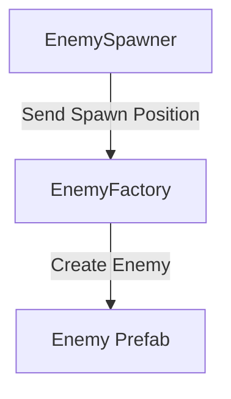

# Mini Survivor

**Name:** Yushan Zulipukaer 
**Student Number:** 100985617

## Project Description

This is a simple 2D survival game inspired by Vampire Survivors.

The player can move around the map using WASD. Enemies will keep spawning around the player and move toward the player. The player attacks automatically by shooting projectiles at the closest enemy.

## Gameplay Loop

The main gameplay loop is:

1. The player moves around the map using WASD.
2. Enemies keep spawning around the player.
3. Enemies move toward the player.
4. The player automatically finds the closest enemy and shoots a projectile.
5. The enemy takes damage when it is hit by a projectile.
6. The enemy is destroyed when its health reaches zero.
7. The player takes damage if an enemy touches the player.
8. The game ends when the player's health reaches zero.

## Controls

- **W** - Move Up
- **A** - Move Left
- **S** - Move Down
- **D** - Move Right

The player attacks automatically, so there is no attack button.

---

## Design Pattern

The main design pattern used in this project is the Factory Design Pattern.

I used an EnemyFactory to create enemies in the game.

Instead of creating the enemy directly inside the EnemySpawner, the spawner sends the spawn position to the factory.

The factory is responsible for creating the enemy prefab at that position.

## Factory Pattern Diagram

## Reflection

### What element of your game adopts the chosen pattern?

The enemy spawning system uses the Factory Design Pattern.

The EnemySpawner decides when and where the enemy should spawn. However, it does not create the enemy directly. Instead, it sends the spawn position to the EnemyFactory.

The EnemyFactory is responsible for creating the enemy prefab at the given position.

Currently, my game only has one type of enemy, but more enemy types can be added in the future.

### Why is this pattern a good choice for the associated functionality?

I think the Factory Pattern is a good choice for the enemy spawning system because it separates the spawning logic and the enemy creation logic.

The EnemySpawner only needs to control the spawn time and position. The EnemyFactory is responsible for creating the enemy.

This makes the code easier to understand and organize. It also makes the game easier to expand. For example, if I want to add a fast enemy or a stronger enemy later, I can update the factory without putting all the creation code inside the spawner.
