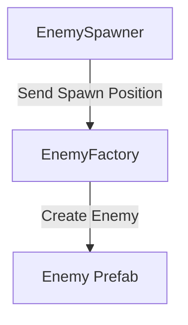

# Mini Survivor

**Name:** Yushan Zulipukaer 
**Student Number:** 100985617

## Project Description

This is a simple 2D survival game inspired by Vampire Survivors.

The player can move around the map using WASD. Enemies will keep spawning around the player and move toward the player. The player attacks automatically by shooting projectiles at the closest enemy.

## Gameplay Loop

The main gameplay loop is:

1. The player moves around the map using WASD.
2. Enemies keep spawning around the player.
3. Enemies move toward the player.
4. The player automatically finds the closest enemy and shoots a projectile.
5. The enemy takes damage when it is hit by a projectile.
6. The enemy is destroyed when its health reaches zero.
7. The player takes damage if an enemy touches the player.
8. The game ends when the player's health reaches zero.

## Controls

- **W** - Move Up
- **A** - Move Left
- **S** - Move Down
- **D** - Move Right

The player attacks automatically, so there is no attack button.

---

## Design Pattern

The main design pattern used in this project is the Factory Design Pattern.

I used an EnemyFactory to create enemies in the game.

Instead of creating the enemy directly inside the EnemySpawner, the spawner sends the spawn position to the factory.

The factory is responsible for creating the enemy prefab at that position.

## Factory Pattern Diagram

## Reflection

### What element of your game adopts the chosen pattern?

The enemy spawning system uses the Factory Design Pattern.

The EnemySpawner decides when and where the enemy should spawn. However, it does not create the enemy directly. Instead, it sends the spawn position to the EnemyFactory.

The EnemyFactory is responsible for creating the enemy prefab at the given position.

Currently, my game only has one type of enemy, but more enemy types can be added in the future.

### Why is this pattern a good choice for the associated functionality?

I think the Factory Pattern is a good choice for the enemy spawning system because it separates the spawning logic and the enemy creation logic.

The EnemySpawner only needs to control the spawn time and position. The EnemyFactory is responsible for creating the enemy.

This makes the code easier to understand and organize. It also makes the game easier to expand. For example, if I want to add a fast enemy or a stronger enemy later, I can update the factory without putting all the creation code inside the spawner.

---

# Lab 2 - Performance Optimization

## Optimization Overview

For this lab, I used the same Mini Survivor project from Lab 1 and implemented the Object Pool Pattern to improve the projectile system.

Before optimization, the game used Instantiate() to create a new projectile every time the player attacked. The projectile was destroyed when it hit an enemy or reached its lifetime.

After optimization, I created a ProjectilePool that stores 40 projectiles. When the player shoots, the system looks for an inactive projectile and uses it again.

Instead of destroying the projectile, I use SetActive(false) to make it inactive. This allows the projectile to be reused later.

## Profiling Method

I used Unity Profiler and Profile Analyzer to measure the performance before and after optimization.

Both versions were tested using Windows Development Builds with the same settings.

- Fire Interval: 0.1 seconds
- Initial Pool Size: 40 (After only)
- Frames Analyzed: 1,999 for each version

I compared the CPU frame time, object creation and destruction calls, and GC allocation.

## Profiler Screenshots

### Before Optimization

**CPU Profiling**

**Memory Profiling**

### After Optimization

**CPU Profiling**

**Memory Profiling**

### Profile Analyzer Comparison

## Performance Results

| Measurement | Before | After |
|---|---|---|
| Frames Analyzed | 1,999 | 1,999 |
| Mean PlayerLoop Time | 4.17 ms | 4.17 ms |
| Median PlayerLoop Time | 4.16 ms | 4.17 ms |
| Maximum PlayerLoop Time | 11.69 ms | 8.33 ms |
| Instantiate.Produce Calls | 98 | 17 |
| Destroy Calls | 96 | 17 |
| Mean GC Allocation per Frame | 8 B | 4 B |
| Maximum GC Allocation per Frame | 200 B | 144 B |
| Total GC Allocation | 16.1 KB | 7.9 KB |

The results show that the number of Instantiate and Destroy calls decreased after using Object Pooling.

The total GC allocation decreased from 16.1 KB to 7.9 KB, which is about a 51% reduction.

However, the mean PlayerLoop time stayed at 4.17 ms. This means the optimization reduced object creation and memory allocation, but it did not significantly improve the overall CPU frame time.

These measurements include the whole game, not only the projectile system.

## Reflection

### 1. What did you notice was impacting the performance of your project?

Before optimization, the game was repeatedly creating and destroying projectiles.

I noticed that these operations could create extra work for the CPU and memory management.

I also noticed that a lot of frame time was spent waiting for rendering and frame updates.

### 2. Which pattern(s) did you implement, and what behavior did they replace?

I implemented the Object Pool Pattern for the projectile system.

Originally, the AutoShooter used Instantiate() to create a new projectile every time the player attacked. The projectile was destroyed after hitting an enemy or reaching its lifetime.

After optimization, the game creates a pool of projectiles at the beginning. The AutoShooter gets an inactive projectile from the pool and activates it.

When the projectile is no longer needed, it becomes inactive instead of being destroyed.

### 3. Do your patterns or techniques improve performance? Why or why not?

Yes, the Object Pool Pattern improved some parts of the game's performance.

The Instantiate.Produce calls decreased from 98 to 17, and the Destroy calls decreased from 96 to 17.

The total GC allocation also decreased by about 51%.

However, the average PlayerLoop time did not change much.

I think this is because my game is relatively small, so creating and destroying projectiles was not a large part of the total frame time.

Object Pooling reduced unnecessary operations, but it did not make the overall CPU frame time significantly faster in this test.

### 4. Can you demonstrate what the profiling process revealed?

I used Unity Profiler to record the game before and after optimization. Then I used Profile Analyzer to compare the results.

The results showed fewer Instantiate and Destroy calls after Object Pooling was implemented. GC allocation was also lower.

However, the average PlayerLoop time stayed almost the same. I also noticed that some frame time was spent waiting, such as WaitForTargetFPS.

This showed me that reducing object creation does not always lead to a large improvement in overall frame time.

I learned that profiling is important because it helps me understand whether an optimization actually works.
